# The Boys · London Move Planner

**A quote request and pricing system for a London removals company, built as a freelance project.**

Customers fill in one form, and the system takes it from there: it prices the job,
notifies the business owner, and emails the customer their quote once it's approved.

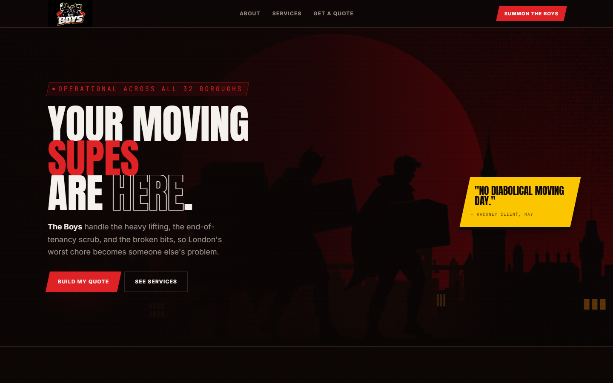

|              |                                                                                     |
| ------------ | ----------------------------------------------------------------------------------- |
| **Client**   | The Boys, a removals, cleaning and handyman company in London                       |
| **My role**  | Sole freelance developer, from requirements to deployment                           |
| **Timeline** | May to September 2026                                                               |
| **Stack**    | React, TypeScript, TanStack Start, Tailwind CSS, Supabase, Airtable, Brevo, Railway |
| **Status**   | Delivered and deployed. The source code is private at the client's request          |

## The problem

Every enquiry was priced by hand, after several messages back and forth to gather the
details. Leads went cold and quotes were inconsistent.

## What I built

- **A responsive quote form** tailored to houses, apartments and offices, with photo upload
- **Automatic pricing** that turns the form answers into a consistent estimate on the server
- **An approval workflow** in Airtable, where the owner accepts or rejects each quote
- **Automated, branded emails** at every stage, sent from the company's own domain
- **Secure data handling**, with customer data protected in the database and a UK GDPR
  privacy policy

## How it works

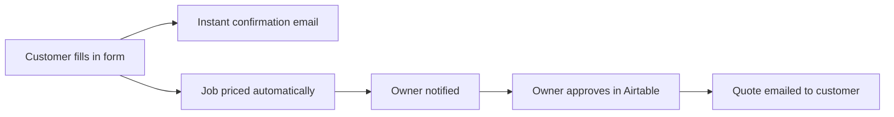

### 1. The customer picks a property type and fills in the form

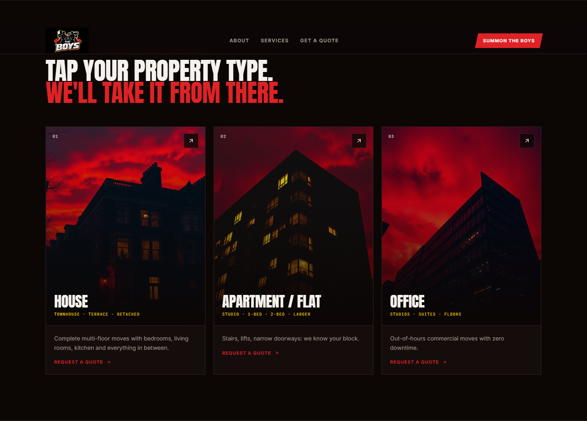

|                       Details and access                        |                   Furniture, extras and photos                   |
| :-------------------------------------------------------------: | :--------------------------------------------------------------: |
| 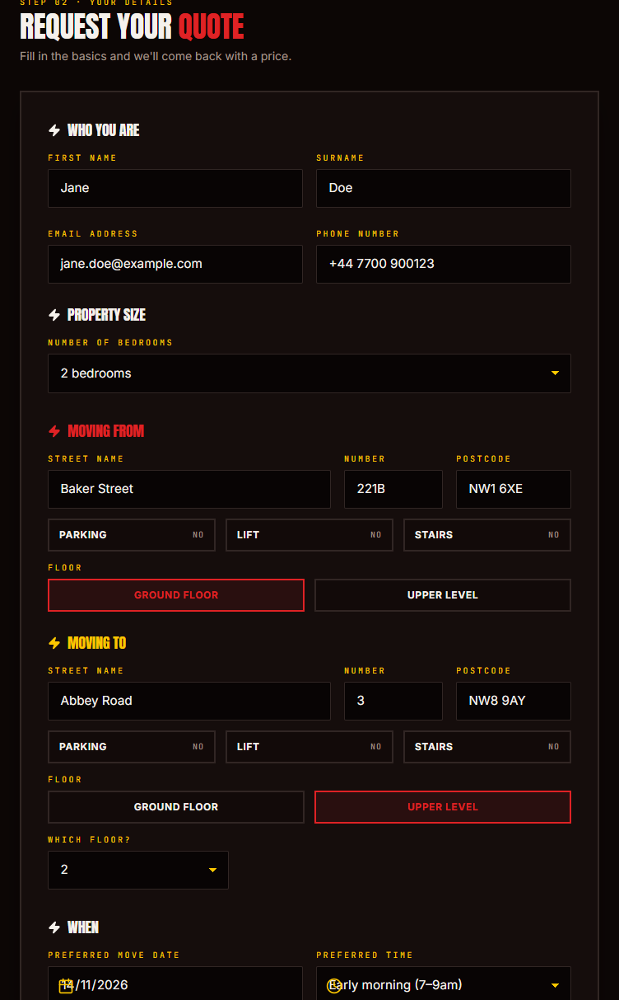 | 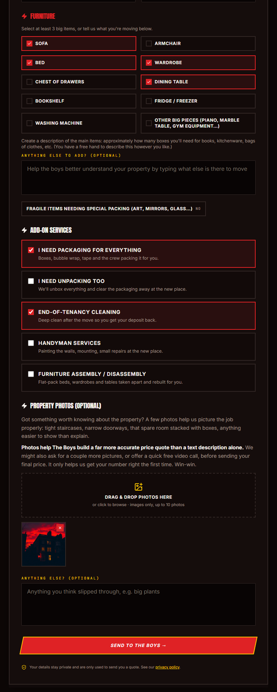 |

The site works on mobile too:

|                                       Landing page                                       |                                     Quote form                                      |
| :--------------------------------------------------------------------------------------: | :---------------------------------------------------------------------------------: |
| 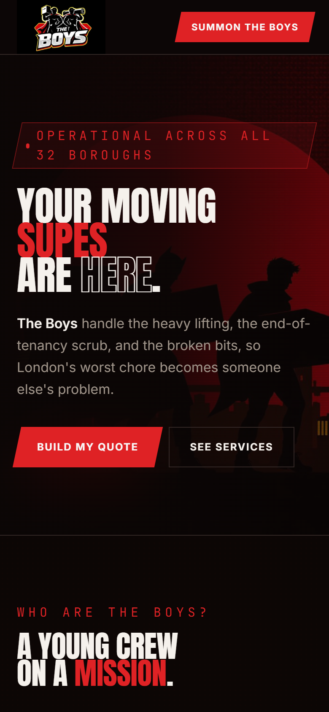 | 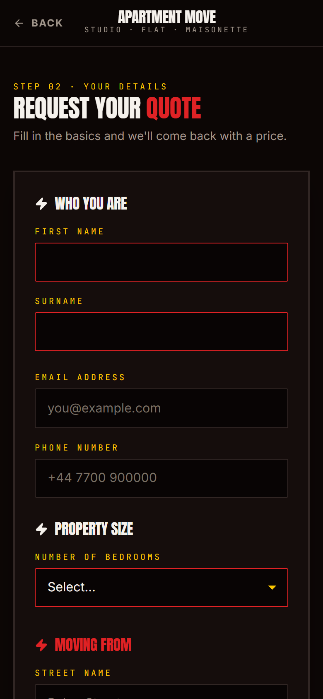 |

### 2. The request is confirmed instantly

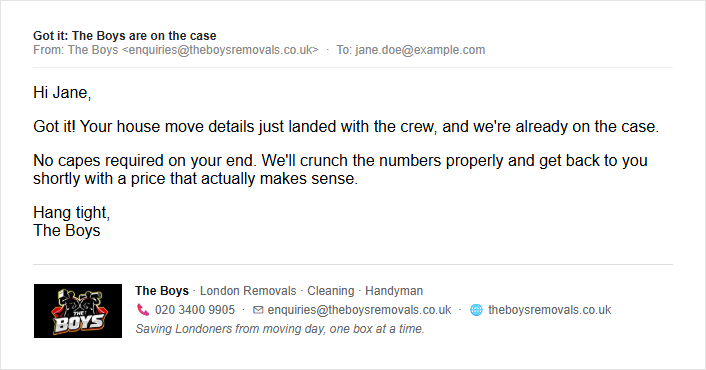

### 3. The job is priced and the owner is notified

The estimate is calculated automatically on the server, saved, and sent to the owner's
Airtable for review.

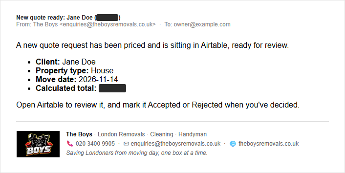

### 4. The owner decides, and the customer hears back automatically

|                            Quote accepted                             |                            Quote declined                             |
| :-------------------------------------------------------------------: | :-------------------------------------------------------------------: |
| 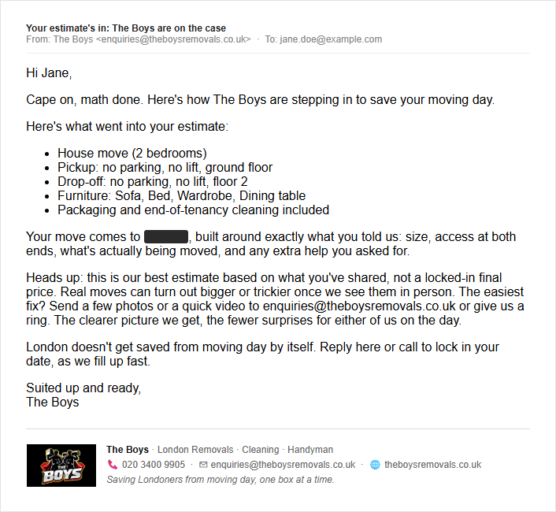 | 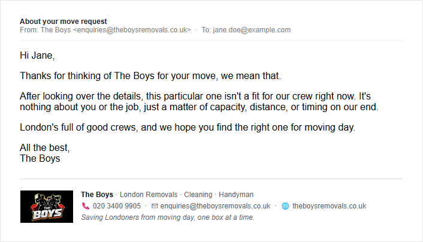 |

Prices are hidden at the client's request.

## Highlights

- Designed and built the full system alone: UI, database, pricing logic, integrations
  and deployment
- Kept customer data secure, with sensitive keys held only on the server
- Set up email authentication on the client's domain so automated emails reach the inbox
- Kept running costs at zero by building the workflow around free-tier services
- Tested the complete flow end to end in a real browser, against the live services

## Source code

The source code is kept private at the client's request. I'm happy to walk through it
on a call.
